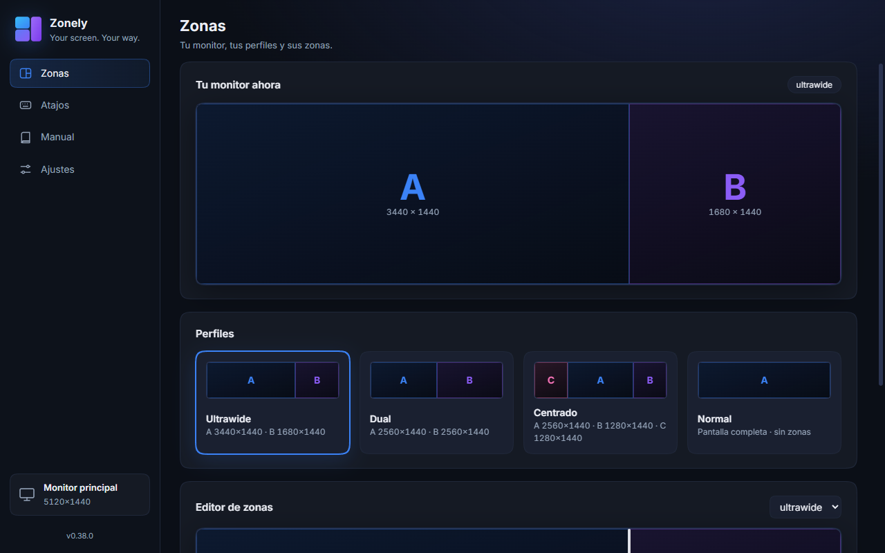
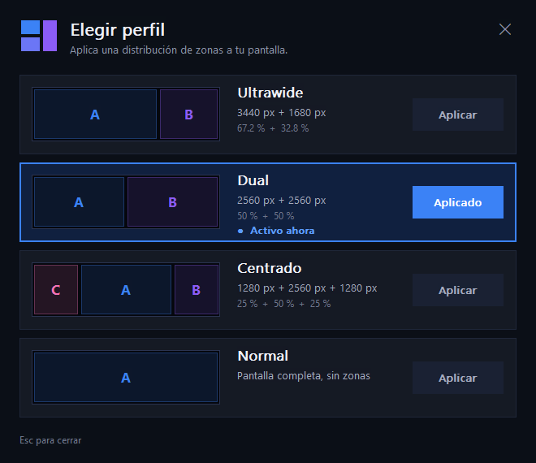
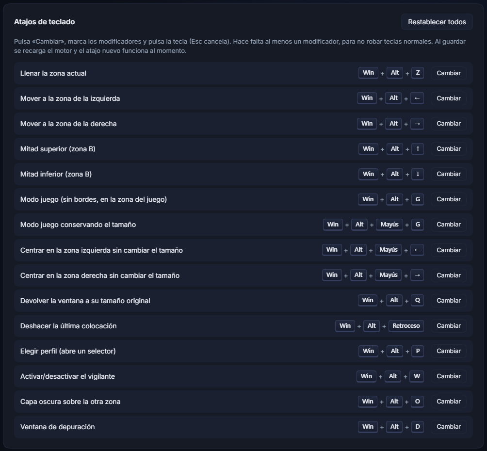

# Zonely

**Your screen. Your way.** · [Read in English](README.md)

Zonely divide un monitor grande en **zonas** independientes y coloca tus ventanas en ellas: el juego a la izquierda, y Discord, el navegador u OBS a la derecha, como si tuvieras dos monitores. Pensado para pantallas ultrawide, pero sirve con cualquier monitor: la primera vez, Zonely calcula los perfiles para tu monitor principal y después puedes editar las zonas.



> **Estado:** Windows es la versión madura; la de **macOS (Apple Silicon) es nueva y experimental**. Software joven: puede tener asperezas. Las incidencias y los *pull requests* son bienvenidos.

## Qué hace
- **Varios monitores** — elige a cuál se aplican las zonas (Monitor, abajo a la izquierda del panel). **Cada monitor guarda sus propios perfiles**: puedes usar «normal» en uno y «ultrawide» en otro.
- **Zonas y perfiles** — «ultrawide» (3440 + 1680), «dual» (2560 + 2560), «centrado» (16:9 en el centro y una zona a cada lado) y «normal» (sin zonas: Zonely no toca tus ventanas). **Editor de perfiles:** crea tus propios perfiles y divide la pantalla **en vertical y en horizontal** a tu gusto (hasta 6 zonas), arrastra las líneas para ajustar, copia o elimina perfiles.
- **Idiomas** — español, inglés, francés, alemán, portugués e italiano (Ajustes → Idioma; por defecto, el del sistema).
- **Selector de perfiles** (`Win+Alt+P`) con un aviso breve al cambiar.
- **Encajar arrastrando** — mantén `Shift` (o `Ctrl` / `Alt`: se elige en Ajustes) mientras arrastras una ventana y suéltala sobre una zona (mitades arriba/abajo opcionales).
- **Vigilante de maximizado** — una ventana maximizada a todo el monitor vuelve a su zona (con lista de exclusiones). y va a su zona, si quieres.
- **Recuperar tamaño** — si sacas una ventana de su zona, recupera su tamaño original.
- **Modo juego** — ventana sin bordes en la zona que elijas, o conserva el tamaño del juego y lo centra.
- **Capa oscura** — oscurece la otra zona (negro puro: píxeles apagados en un OLED) sin bloquear el ratón.
- **Lista de juegos** — los procesos de `Games=` (Rainbow Six Siege por defecto) nunca se mueven ni se redimensionan solos.
- Todos los atajos se pueden cambiar desde el panel. El icono de la bandeja / barra de menús también permite cambiar de perfil.
- **Ligera con la batería:** sin sondeos constantes: reacciona a eventos del ratón y de las ventanas y duerme cuando no hay nada que hacer.

<p>


</p>

## Instalar (Windows 10/11)
1. Descarga `Zonely-Setup-<versión>.exe` desde la página de [Releases](../../releases) y ejecútalo.
2. Windows puede mostrar «Windows protegió su PC»: pulsa **Más información → Ejecutar de todas formas**. El instalador **aún no está firmado** (los certificados cuestan dinero), por eso SmartScreen avisa de editor desconocido. Puedes comprobar el SHA-256 que figura en las notas de la versión.
3. Sigue el asistente. Al terminar arranca el motor (también arranca con Windows) y se abre el panel.

Tus ajustes viven en `%APPDATA%\Zonely` (`zones.ini`, registros): actualizar o reinstalar nunca los pisa, y desinstalar tampoco los borra.

**Actualizaciones:** Zonely se actualiza sola. A los pocos minutos de arrancar, y después cada 6 horas, el motor lanza una comprobación sin ventana: si hay una versión nueva en GitHub, la descarga, comprueba su SHA-256, la instala y reinicia el motor, sin preguntar ni enseñar nada (en macOS sustituye `Zonely.app`, y puede que macOS pida de nuevo el permiso de Accesibilidad). Se puede apagar en *Ajustes → Actualizaciones → Actualizar automáticamente*; entonces Zonely te avisa con una pregunta cuando hay una versión nueva (una vez por versión). El botón *Buscar ahora* siempre está. No hay botón de «recargar»: los cambios de `zones.ini` se detectan solos.

La guía ilustrada completa está en [`manual/index.html`](manual/index.html) y en la sección **Manual** del panel.

## Instalar (macOS, Apple Silicon)
1. **Lo más fácil, sin avisos de seguridad:** pega esto en la Terminal. Descarga la última release con `curl`, comprueba su SHA-256 y copia Zonely a Aplicaciones. Lo descargado con `curl` no queda marcado como «en cuarentena», así que macOS abre la app directamente (puedes leer antes el script: [`scripts/install-mac.sh`](scripts/install-mac.sh)).
   ```bash
   curl -fsSL https://raw.githubusercontent.com/denisalexandrescu8-dotcom/zonely/main/scripts/install-mac.sh | bash
   ```
   O descarga `Zonely-<versión>-mac-arm64.dmg` desde [Releases](../../releases), ábrelo y arrastra **Zonely** a Aplicaciones.
2. Si usaste el `.dmg` desde el navegador: la app **no está notarizada** (hace falta una cuenta de pago de Apple Developer), así que macOS la bloquea la primera vez. Abre **Ajustes del Sistema → Privacidad y seguridad**, baja hasta el aviso sobre Zonely y pulsa **Abrir igualmente**.
3. Zonely necesita el permiso de **Accesibilidad** para mover ventanas de otras apps: Ajustes del Sistema → Privacidad y seguridad → Accesibilidad → activa *ZonelyEngine*. El icono de la barra de menús tiene un acceso directo a ese panel.
4. En macOS los atajos son **⌃⌥ + tecla** (por ejemplo ⌃⌥Z), editables en el panel. El modo juego llena la zona (macOS no permite quitar los bordes de la ventana de otra app). Los ajustes están en `~/Library/Application Support/Zonely`.

Hay un manual de uso para macOS en [`manual/mac.html`](manual/mac.html), también en la sección **Manual** del panel.

## Atajos de fábrica (macOS)
| Atajo | Acción |
|---|---|
| `⌃⌥Z` | Llenar la zona actual |
| `⌃⌥←` / `→` | Mover a la zona de la izquierda / derecha |
| `⌃⌥↑` / `↓` | Mitad superior / inferior (zona B) |
| `⇧` + arrastrar | Encajar en una zona |
| `⌃⌥G` | Modo juego (llenar la zona del juego) / restaurar |
| `⌃⌥⇧G` | Modo juego conservando el tamaño |
| `⌃⌥⇧←` / `→` | Centrar en la zona izquierda / derecha sin cambiar el tamaño |
| `⌃⌥⌫` | Deshacer la última colocación |
| `⌃⌥Q` | Devolver la ventana a su tamaño original |
| `⌃⌥P` | Elegir perfil |
| `⌃⌥W` | Activar/desactivar el vigilante |
| `⌃⌥O` | Capa oscura sobre las zonas que no están activas |

## Atajos de fábrica (Windows)
| Atajo | Acción |
|---|---|
| `Win+Alt+Z` | Llenar la zona actual |
| `Win+Alt+←` / `→` | Mover a la zona de la izquierda / derecha |
| `Win+Alt+↑` / `↓` | Mitad superior / inferior (zona B) |
| `Shift` + arrastrar | Encajar en una zona |
| `Win+Alt+G` | Modo juego (sin bordes en la zona) / restaurar |
| `Win+Alt+Mayús+G` | Modo juego conservando el tamaño interior |
| `Win+Alt+Mayús+←` / `→` | Centrar en la zona A / B sin cambiar el tamaño |
| `Win+Alt+Retroceso` | Deshacer la última colocación |
| `Win+Alt+Q` | Devolver la ventana a su tamaño original |
| `Win+Alt+P` | Elegir perfil |
| `Win+Alt+W` | Activar/desactivar el vigilante |
| `Win+Alt+O` | Capa oscura sobre la zona que no está activa |
| `Win+Alt+D` | Ventana de depuración de la ventana activa |

## Cómo funciona
Dos piezas que hablan por dos ficheros pequeños (sin red):
- el **motor** — un script de [AutoHotkey v2](https://www.autohotkey.com/) (compilado a `ZonelyEngine.exe` en el instalador) que mueve las ventanas, escucha los atajos y trabaja en segundo plano;
- el **panel** — una app [Electron](https://www.electronjs.org/) para ver el estado y cambiar ajustes. Se puede cerrar: el motor sigue funcionando.

## Limitaciones
- Los juegos en **pantalla completa exclusiva** deciden su propio tamaño; Zonely no puede meterlos en una zona. Usa el modo *sin bordes* o *ventana* del juego.
- El **anti-cheat estricto** (Vanguard, FACEIT, BattlEye en algunos juegos…) puede bloquear cualquier cambio en la ventana del juego. Zonely no intenta saltárselo.
- Las ventanas de programas ejecutados **como administrador** no se pueden mover si el motor no está elevado.

## Ejecutar desde el código
Necesitas [AutoHotkey v2](https://www.autohotkey.com/) y [Node.js](https://nodejs.org/).

```bash
cd panel
npm install
npm start
```

Después, doble clic en `ZoneManager.ahk` para lanzar el motor (o el interruptor **Motor** de Ajustes en el panel).

## Construir el instalador
```powershell
powershell -ExecutionPolicy Bypass -File scripts\build-installer.ps1 -Ahk2Exe C:\ruta\Ahk2Exe.exe
```
Compila el motor con [Ahk2Exe](https://github.com/AutoHotkey/Ahk2Exe/releases) y lo empaqueta todo con electron-builder en `dist\installer\`. Requiere AutoHotkey v2 y `npm install` dentro de `panel/`. El historial de cambios está en [`CHANGELOG.md`](CHANGELOG.md).

## Traducciones
Los textos del panel están en `panel/locales.js` y los de los motores (menús, avisos, selector de perfiles) en `i18n/engine.js`; el texto en español es la clave y cada fila lleva una columna por idioma. Para añadir un idioma: una columna más, su código en `LOCALE_ORDER` / `ORDER` su nombre en `panel/i18n.js` y su código en `LANGS` (`panel/main.js`); después, `node scripts/gen-strings.js` regenera las tablas de los motores. Los manuales están en español por ahora.

## Licencia
Zonely es software libre bajo la **GNU GPL, versión 2** ([`LICENSE`](LICENSE)). Puedes usarlo, estudiarlo, modificarlo y compartirlo; si distribuyes una versión modificada, debes publicarla con su código fuente bajo la misma licencia. El motor lleva dentro el intérprete de AutoHotkey (GPL v2), y por eso todo el proyecto usa esa licencia. Las licencias de terceros están en [`THIRD_PARTY.md`](THIRD_PARTY.md).
